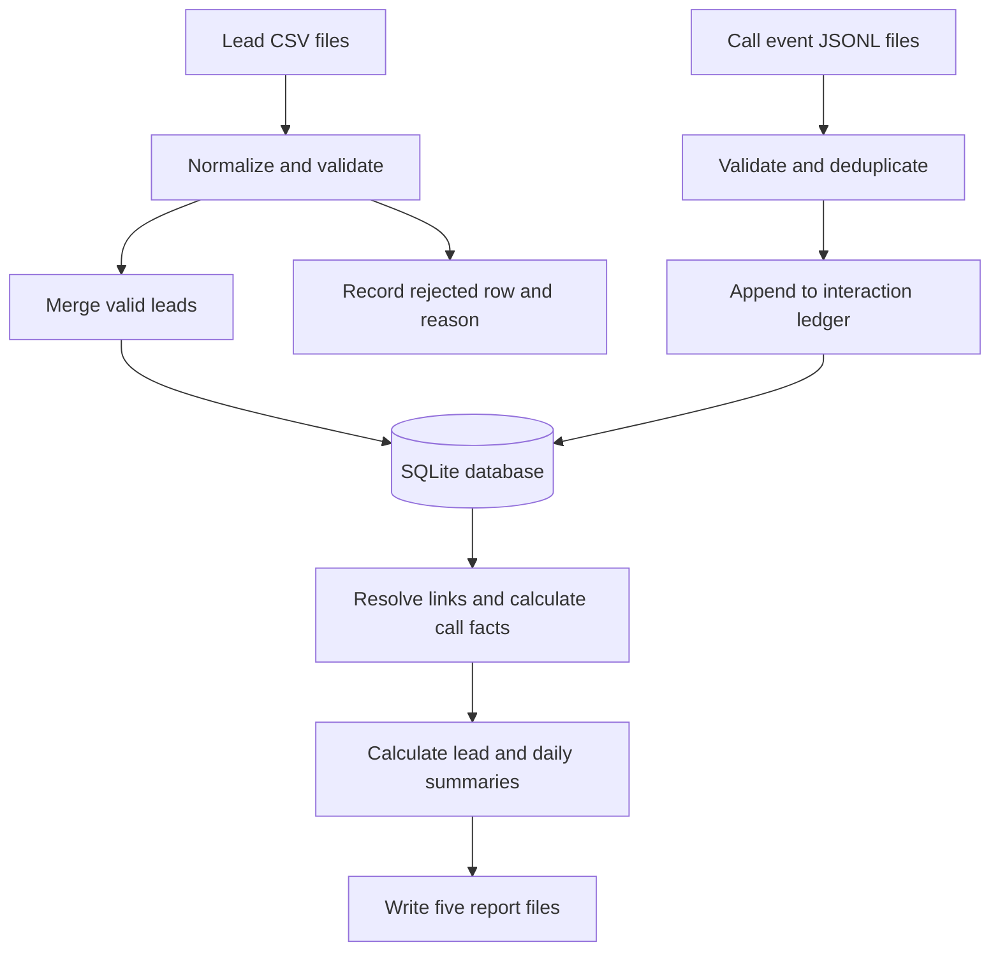

# How the Assignment A solution works

## The problem

A voice-calling business receives customer lists and call activity from different systems.
Those files contain duplicates, inconsistent phone formats, invalid rows, and events that
arrive out of order. Reports still need to say exactly who was called and what happened.

This pipeline combines the inputs into a database and generates five reports. It does
not place calls; call dispatching belongs to Assignment B.

## An example

Suppose a customer appears in a motor-renewal upload with phone `9876543210`. A later
upload uses `+91 98765 43210` for that customer.

1. Both values normalize to `+919876543210`.
2. The workflow and phone identify one lead, so the later row merges into that lead.
3. The original batch stays unchanged; later valid non-null fields replace earlier values.
4. A `call.initiated` event creates a counted call when it links to that lead.
5. A `call.connected` event marks the call as connected.
6. A `disposition.set` event with `renewed` makes that call successful and terminal.
7. Reports show the lead as completed and display only `+91******3210`.

If a supervisor later overrides the outcome, the new event changes the effective result
without deleting or editing the earlier event.

## Processing stages

### Lead ingestion

Headers match schema names or aliases after normalization. Values are trimmed and parsed
according to type. Blank rows are skipped. The first validation failure in schema order
becomes the row's rejection reason. Invalid optional values become null and add a warning
only if the row is accepted.

A lead's identity is `(workflow_id, canonical_phone)`. Including the workflow keeps the
same person's renewal and feedback records separate. The database uses a keyed phone
hash in place of the plaintext phone in its primary key.

### Event ingestion

Every nonblank JSONL line counts toward the input total. Malformed records are counted
and skipped; repeated accepted event IDs are counted as duplicates. Valid unique events
are retained in the ledger, including events that cannot yet link to a lead.

Ordinary events link using workflow and normalized phone. Only a supervisor override
can link using its workflow and call ID without a phone. An invalid-phone connected
event cannot borrow the lead from another event's call ID.

### Reporting

Reports resolve event links using everything ingested so far. An orphan from drop 1 can
become usable after its lead arrives in drop 2. Remaining orphans stay out of call totals.

A counted call must have a linked `call.initiated` event. Its date is the initiation date
in IST. A call is connected when it has a linked connected event. Unknown disposition
codes are counted and excluded from effective-outcome selection.

The latest supervisor override takes precedence over all automated disposition sets,
as required by the assignment. If no valid override exists, the latest valid set wins.
The order of file arrival does not determine the latest outcome; event timestamps do.

## Lead progress buckets

Evaluate these rules in order:

| Priority | Bucket | Rule |
|---|---|---|
| 1 | `yet_to_reach_out` | No counted calls |
| 2 | `completed` | At least one call has a terminal effective disposition |
| 3 | `in_progress_telephony_failed` | Every counted call has a telephony-failure event |
| 4 | `in_progress_dialed` | All other leads with calls |

Completed does not always mean successful. For example, a terminal refusal ends the
workflow but does not count as a renewal. The disposition catalogue defines both flags.

## Protecting customer data

AES-256-GCM encrypts names and full phones with a fresh random nonce. HMAC-SHA256 creates
a stable phone lookup value so events can match leads without decrypting every record.
The masked phone supports reporting. Neither key is stored in the database or repository.

Both keys must stay stable for the database. Stored key verifiers reject accidental key
changes before ingestion. This guards against configuration mistakes; someone holding
the keys can still decrypt customer data. Key rotation is not implemented.

## Repeat runs and failures

The database records each input file's absolute path and content hash. Replaying an
unchanged file skips its writes and counters. Copying or editing a lead file makes it
fresh input, so corrected backfills should use a new database.

Data, file tracking, and counters commit in the same transaction for each file. A failed
file rolls back together. Earlier completed files remain available and can be skipped on
retry. This implementation is intended for one ingestion process at a time.

See [SUBMISSION.md](../SUBMISSION.md) for measured validation results and limitations,
and the [solution README](../solution/README.md) for commands and troubleshooting.
